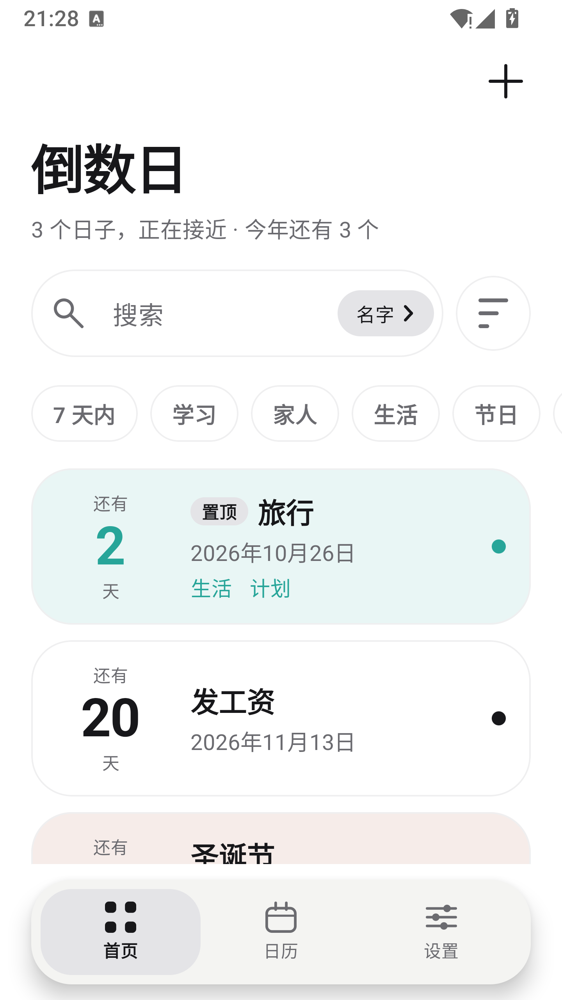
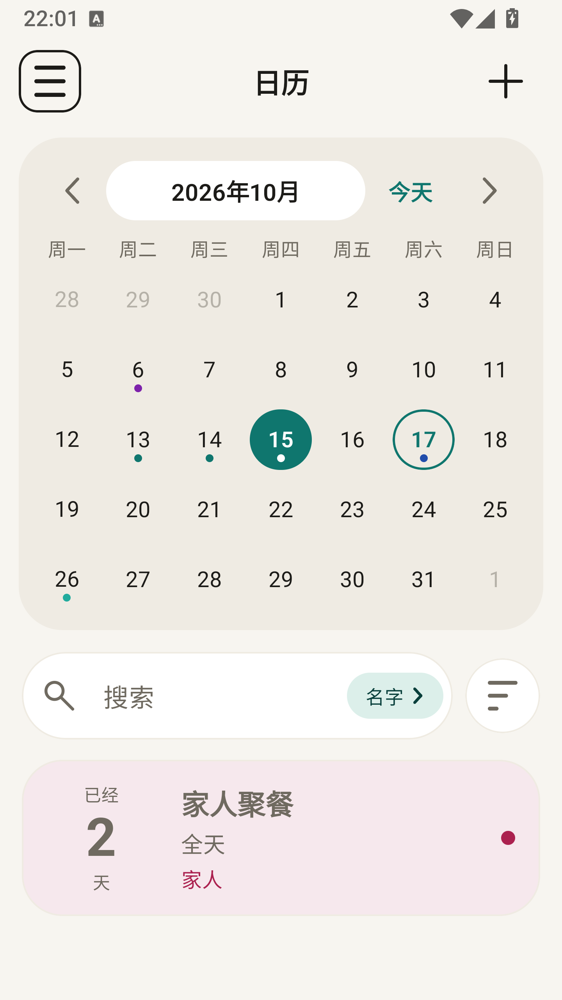
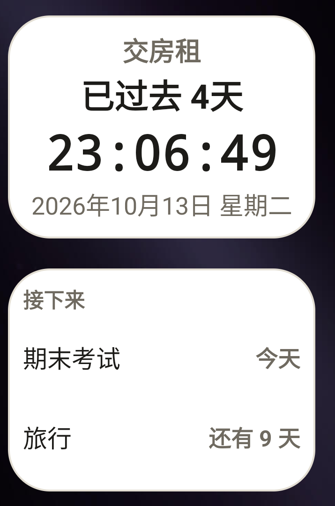
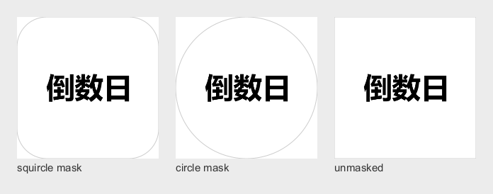

# TickCount

[](https://github.com/ZZPBY/tickcount/actions/workflows/android.yml)
[](LICENSE)

一个极简、纯离线的安卓倒数日日历。在日历上点一天、起个名字，就能看到离那一天还有多久，
或者已经过去了多久。

[English](README.en.md)

**约 2 MB · 零权限 · 纯离线 · 无广告 · 无账号 · 开源**

<p align="center">
  
  
  
</p>

## 功能

- **侧边栏** —— 点左上角菜单打开半个屏幕的抽屉：主页、日历，外观与显示、数据管理，更新日志、
  项目介绍；「语言」单独在最下面一行。
- **倒数日列表** —— 一条一张卡片：左边是超大号的天数，右边是名称、标签和日期（填了时间就
  一起显示）。已经过去的收在列表最下面，用「已过去」隔开。
- **置顶与排序** —— 置顶的不受排序影响，始终在最前；排序可选用按日期近的在前、远的在前，
  或按添加时间新的在前，选择会记住。它只管还没过去的那段。
- **搜索与筛选** —— 列表上方一个搜索框，右侧可选按名称（含标签）、日期或时间筛选；下面一行
  胶囊可以只看「7 天内」，或按某个标签筛。标题下面那行还会说明今年还有几个。
- **精确到分钟** —— 可以是「全天」，也可以指定到某时某分。
- **多标签、自定义颜色** —— 标签不限个数；颜色在编辑页用色相条调，不指定就用主题色。
- **倒数日详情** —— 点卡片进入：年月日时分秒的完整拆分，以及置顶开关、日期、时间和标签。
- **日历** —— 手写月历，一天有多个倒数日时最多显示三个圆点；点一天，那天的倒数日列在下方，
  同样能搜索和排序。
- **快速翻月** —— 点月份标题弹出年月选择窗，可一步回到本月，也能 ±1 年、±10 年翻页。
- **长按卡片** —— 直接置顶、编辑或删除，不必先进详情页；删除前会先确认。
- **一键添加多个** —— 新建时填上间隔天数和个数，一次添加一串同名、同标签、同颜色、同时间的
  倒数日；添加前会告诉你有几条、最后一条落在哪天。
- **桌面小组件** —— 两种：**单个**把一条倒数日放到桌面、时分秒实时跳动；**清单**列出接下来
  要数的几条。都随尺寸调整，都不需要任何权限。
- **外观** —— 大圆角卡片配 1px 细描边、超大的天数层级。主题有白、黑、青绿、雾蓝、暖橙、玫瑰，
  外加自定义色相；「白」是纯白底配接近黑色的强调色，「青绿」保持暖纸底，其余几套的页面、
  面板和描边都跟着主题色明显变化。配色固定，不跟随系统深色开关，也不从壁纸取色；秒数可以
  关掉，倒计时只走到分钟。
- **中英双语** —— 跟随系统语言，也可以在侧边栏手动选；日期格式一并切换。
- **备份与恢复** —— 把全部倒数日，以及外观、排序和语言设置导出成一个文件，也能读回来。
  导出可加密码（AES-256-GCM 加密）；导入先验密码，再选「覆盖」或「合并」，并会先告诉你
  会新增、覆盖或丢弃几条。另有一个「导出日历文件」，写成 .ics 交给系统日历。
- **更新日志 / 项目介绍** —— 侧边栏里按版本列出历次改动，当前版本会标出来；项目介绍就在
  应用内，含可复制、可跳转的 GitHub 地址。
- **大字体** —— 标题栏、侧边栏和卡片都避开状态栏，并跟随系统字体缩放长高，不挤压文字。
- **不需要任何权限、不联网、无统计。** 单模块，运行时不依赖任何第三方库，`minSdk` 27。

## 一键添加多个

名字、标签、颜色和时间只填一遍。新建时打开「一键添加多个」，再填两个数：

- **间隔天数** —— 相邻两条之间差几天，1～3650 天。
- **个数** —— 除了上面选的日期，还要再添加几条相同的，1～100 条。

上面选的日期**本身也会添加一条**，之后每条都比前一条多间隔那么多天。所以 10 月 14 日新建
「打副本」、间隔填 2、个数填 3，列表里就会出现 10 月 14、16、18、20 日共 4 条。

时间那一栏选的值，这一串里每一条都跟着走；全天就是全天，09:30 就是 09:30。这些条目算同一批，
所以「按添加时间」排序时它们挨在一起，里面的先后仍按日期排。每一条都是独立的倒数日，之后各自
编辑或删除，互不影响。

## 倒计时的读法

目标是**所选日期当地时间的 00:00**；这条倒数日如果指定了某时某分，就以那个时刻为准。
这个时刻过去之后，同一套算法反向运行，标签从「还有」变成「已过去」；目标日当天显示的是
「今天已过」。

从最高位起，还没有开始计数的字段用短横线占位，所以一眼就能看出还剩多久：

| 剩余时间 | 显示 |
|---|---|
| 4 个月 11 天 6 时 30 分 15 秒 | `----年04月11日 06时30分15秒` |
| 2 天 30 秒 | `----年--月02日 00时00分30秒` |
| 3 年 4 个月 11 天 6 时 30 分 15 秒 | `0003年04月11日 06时30分15秒` |

年、月、天按日历算，小时、分、秒按流逝时间算，所以夏令时切换的那一天仍然算一整天，
哪怕它实际只有 23 或 25 小时。

## 桌面小组件

长按桌面空白处 → 添加小组件，里面有两个可选：

**倒数日 · 单个** —— 再挑一个倒数日（列表里带时间，同名的两条不会挑混）。默认 4×2，拖大拖小
会自己换排版：拖扁了是「名字 + 天数 + 时钟」一行，拖大了再加上目标日期，并把天数拆成
「1年1个月4天」。点它直接打开这条倒数日。填了具体时间的倒数日，它也按那个时刻算，并在日期
那行写出时间（窄排版写在天数后面），和详情页一致。秒针由系统自己走，不额外唤醒应用。

**倒数日 · 清单** —— 不用挑，它自己列出接下来要数的几条，从近到远，一行一条；点哪一行就
打开哪一条。填了具体时间的会写成「今天 09:30」。默认 4×2 放得下三行，拖高了最多四行，
行会撑满整个组件；没有要数的日子时显示一行提示。

两个都**不需要任何权限**。

## 下载

APK 发布在 [Releases](../../releases/latest)，也可以从 **Actions** 标签页里
任意一次成功的构建中下载产物。每个版本改了什么见 [`更新日志.txt`](更新日志.txt)。


## 编译

需要：

- JDK 17
- Android SDK Platform 37 和 Build Tools 36.0.0
- 在 `local.properties` 里写好 SDK 路径，或导出 `ANDROID_HOME`

```bash
./gradlew testDebugUnitTest   # 单元测试
./gradlew assembleRelease     # APK -> app/build/outputs/apk/release/
```

Windows 下使用 `gradlew.bat`。

## 技术栈

| | |
|---|---|
| 语言 | Kotlin 2.4.20 |
| UI | Jetpack Compose + Material 3（Compose BOM 2026.09.00） |
| 构建 | AGP 9.4.1、Gradle 9.6.0，版本集中在 `gradle/libs.versions.toml` |
| SDK | compileSdk 37、targetSdk 36、minSdk 27 |
| 存储 | `SharedPreferences` 里存一个小 JSON 文档 |
| 依赖 | 运行时仅 AndroidX 与 Compose |

`minSdk` 为 27。`java.time` 在 API 26 就有了，主题里的 `windowLightNavigationBar`
在 27 也有了，所以既不需要 `coreLibraryDesugaring`，也不需要任何兼容垫片，
更不必把主题按版本拆成两份。

## 目录结构

```
app/src/main/java/io/github/zzpby/tickcount/
├── MainActivity.kt              边到边宿主 + 应用主题（含状态栏图标配色）
├── data/                        模型与持久化
│   ├── CountdownEvent.kt        倒数日模型：id / 日期 / 时间 / 标签 / 颜色 / 置顶
│   ├── EventCodec.kt            倒数日记录的 JSON 读写，含旧格式迁移
│   ├── EventStore.kt            把上面那份文档存进 SharedPreferences
│   ├── SettingsStore.kt         主题、排序与语言选择的存储
│   ├── Backup.kt                备份文件的格式，以及导入的结果
│   └── BackupCrypto.kt          备份的密码加密（PBKDF2 + AES-GCM）
├── domain/                      纯逻辑，有单元测试
│   ├── Countdown.kt             年/月/天/时/分/秒 的拆解与占位格式化
│   ├── BatchAdd.kt              一键添加多个：按间隔天数铺开一串副本
│   ├── CalendarMath.kt          月历网格构造
│   ├── CountdownList.kt         列表排序、分段与天数距离
│   ├── Search.kt                搜索范围与匹配规则
│   ├── Changelog.kt             把更新日志拆成一个个版本
│   ├── Readme.kt                从 README 里抽取项目介绍的章节
│   └── WidgetCountdown.kt       小组件的天数拆分、形态判定与清单挑选
└── ui/
    ├── MainViewModel.kt         状态 + 全进程唯一的那个时钟
    ├── TickCountApp.kt          根画面：抽屉、屏幕切换、返回键、各弹窗
    ├── AppDrawer.kt             侧边抽屉
    ├── AppTitleBar.kt           标题栏：菜单 / 返回 + 名字 + 动作槽
    ├── HomeScreen.kt            倒数日列表
    ├── CalendarScreen.kt        月历 + 选中那天的倒数日
    ├── EventCard.kt             倒数日卡片，主页与日历共用
    ├── SortButton.kt            排序胶囊：选择列表的排序方式
    ├── SearchField.kt           搜索框与范围选择
    ├── EventDetailScreen.kt     单个倒数日的详细画面
    ├── EventEditorScreen.kt     新建 / 编辑（整屏）：名字、标签、日期、时间、颜色、批量
    ├── DeleteConfirmDialog.kt   删除前的确认弹窗
    ├── AppearanceScreen.kt      外观与显示：六个主题预设 + 自定义色相
    ├── DataScreen.kt            数据管理：导出、导入、可选加密
    ├── ChangelogScreen.kt       更新日志，正文取自本仓库的同名文件
    ├── ProjectIntroScreen.kt    项目介绍，正文抽自本文件
    ├── calendar/                手写月历 + 年月选择窗
    ├── components/              Canvas 图标（含搜索）、色相条、Markdown 渲染、本地化格式
    ├── widget/                  两个桌面小组件：单条与清单的渲染、接收器、配置界面
    └── theme/                   配色、字体，以及形状与间距的共享 token
```

倒计时算法、列表排序、搜索匹配、小组件的天数拆分与清单挑选、更新日志解析、备份编解码与加密、
README 抽取与 Markdown 解析都由 `app/src/test/` 下的单元测试覆盖，包括月长、闰日、
跨年、两种夏令时切换，以及「今天不算已过去」这个容易差一天的边界。

## 应用图标



矢量 XML 无法绘制汉字，因此启动器文字由
[`.tools/图标生成/IconGen.java`](.tools/图标生成/IconGen.java) 栅格化：
它加载微软雅黑，把文字缩放到正好落在 Android 自适应图标的 66dp 安全圆内，
再输出 `res/drawable-xxxhdpi/` 中的 PNG。

```bash
java .tools/图标生成/IconGen.java app/src/main/res/drawable-xxxhdpi/ic_launcher_foreground.png
```

## 隐私

TickCount 只在自己私有的 `SharedPreferences` 中保存一份倒数日列表——日期、名称、时间、
标签、颜色、置顶和添加时间——此外没有别的东西。颜色是每个倒数日自己的颜色，用来在日历
和列表里区分它们。桌面小组件另有一份 `tickcount_widgets`，只记录「哪个小组件显示哪一条
倒数日」；主题、排序和语言存在 `tickcount_settings`。三份都在应用私有目录里，都不会自己
离开设备。

「数据管理」里导出的备份文件写到哪里由你选，加不加密也由你定，应用没有任何办法把它送出去。
它不声明任何权限，不发起网络请求，不含统计与广告。项目介绍里有一个指向本仓库的链接，
点击后在浏览器中打开——TickCount 自己没有联网能力，也没有 `INTERNET` 权限。
这些数据仅在 Android 自身的云备份开启时才会离开设备，而这由 `res/xml/backup_rules.xml` 决定。

## 许可

[MIT](LICENSE)。
